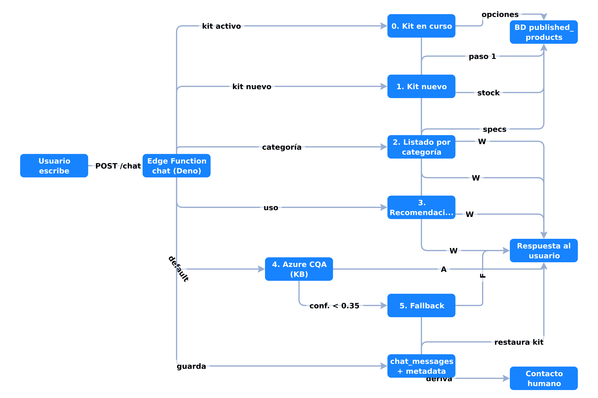
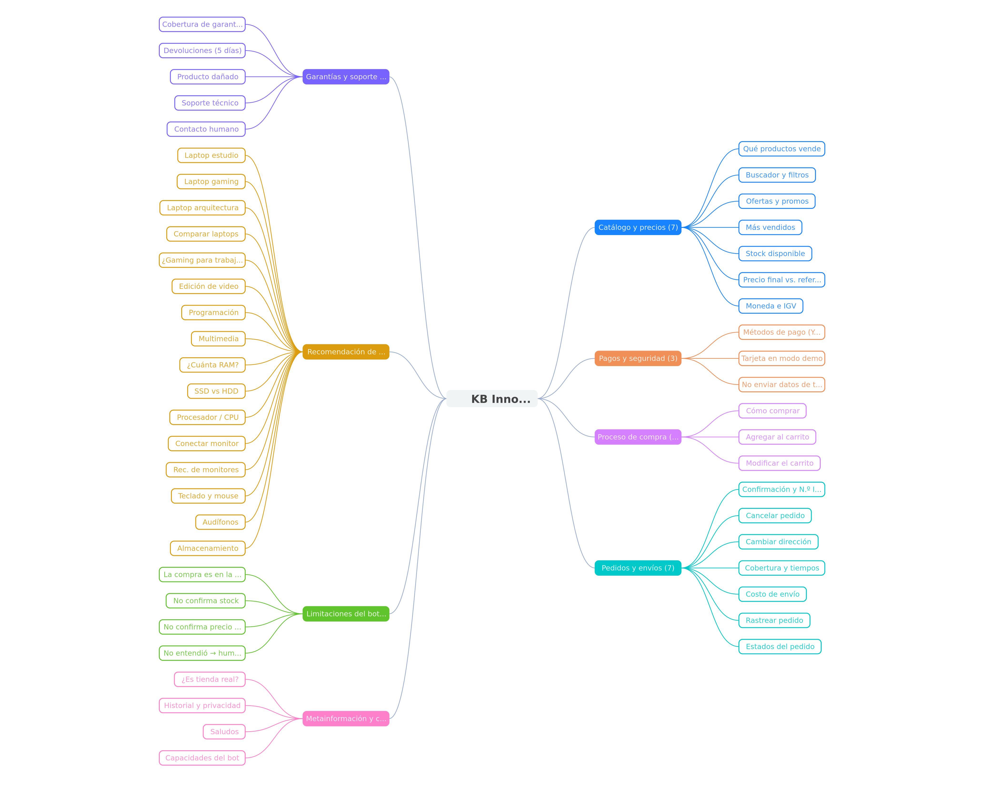

# Integración del bot de Azure en InnovVentas

> Guion para presentación técnica · proyecto InnovVentas (PIAD-627)

---

## 1. Vista panorámica



```
┌─────────────────┐   POST /functions/v1/chat    ┌───────────────────────────┐
│ React (widget)  │ ───────────────────────────▶ │ Edge Function (Deno)      │
│ chat-widget.tsx │  Bearer usuario o apikey     │ supabase/functions/chat   │
│ use-chat.ts     │                              │                           │
│                 │                              │  0. Kit en curso          │
│                 │                              │  1. Kit nuevo             │
│                 │                              │  2. Listado por categoría │
│                 │                              │  3. Recomendación híbrida │
│                 │                              │  4. Azure CQA             │
│                 │                              │  5. Fallback (F)          │──▶ Azure Language
│                 │                              │                           │    (CQA REST API)
│                 │ ◀─────────────────────────── │  Supabase DB (service     │
│                 │   message + metadata         │  role: conversaciones,    │
└─────────────────┘                              │  catálogo, eventos)       │
                                                 └───────────────────────────┘
```

**Frase para la presentación:**

> *"El chat no habla directo con Azure ni con la base de datos desde el navegador: toda la inteligencia vive en una Edge Function de Supabase que actúa como único cerebro y punto de seguridad."*

---

## 2. Cómo está integrado en código

### Frontend (`src/features/chat/`, `src/lib/edge.ts`)

- `ChatWidget` es un componente React montado en el layout global (`AppLayout`), por eso sobrevive a la navegación
- `use-chat.ts` maneja sesión anónima persistida en `localStorage` (`x-innov-session`), el envío optimista del mensaje del usuario y la carga de historial
- `edge.ts` centraliza las llamadas HTTP: `Authorization: Bearer` con el token del usuario si está logueado, o la `apikey` anónima como invitado
- **Punto clave:** llamar a la Edge Function garantiza que la *anon key* del cliente no da ningún permiso directo sobre datos sensibles

### Backend (`supabase/functions/chat/index.ts` — Deno)

- Valida sesión (usuario autenticado o sesión anónima de chat) y evita que una conversación lea los mensajes de otra
- Todo acceso a base de datos es con `SUPABASE_SERVICE_ROLE_KEY` — **las claves de Azure y el service role jamás llegan al navegador**
- Persiste cada mensaje en `chat_messages` (con `confidence` y `metadata`) y cada evento relevante en `chat_events` (por ejemplo, cada fallback queda registrado con su score) → auditable y medible

### Azure (`askCqa()`, líneas 56–94)

- Llamada REST directa a la API de Custom Question Answering (`/language/:query-knowledgebases`)
- La clave viaja como header `Ocp-Apim-Subscription-Key` (secret de la Edge Function, no del front)
- Pide los `top: 3` candidatos de la KB, ordena por `confidenceScore` y usa el mejor si supera el umbral

---

## 3. La estructura de decisión (corazón del sistema)

Cada mensaje recorre una **cascada de rutas en orden de valor de negocio**, y la primera que responde gana:

| Orden | Ruta | Condición de entrada | Dónde toma los datos |
|---|---|---|---|
| 0 | Flujo de kit en curso | `metadata.kit` en el último mensaje | BD (`published_products`) |
| 1 | Armar kit nuevo | Detecta «armar kit gamer/estudio» | BD |
| 2 | Listado por categoría | Nombra una categoría («audífonos») | BD |
| 3 | Recomendación híbrida | Detecta uso («para gaming/estudio») | BD |
| 4 | Azure CQA | Todo lo anterior por defecto | Base de conocimiento de Azure |
| 5 | Fallback | Confianza Azure < 0.35 | Deriva a equipo humano |

### Justificación del orden

- **Lo transaccional primero:** si el usuario está a mitad de una compra asistida (kit), ninguna otra respuesta es válida — sería interrumpir una venta en curso
- **BD antes que Azure en productos:** el catálogo es *fuente de verdad* — precio, oferta y stock cambian en tiempo real y viven en Postgres; la KB de Azure es una *foto estática*. Citar precios de la KB sería mostrar datos viejos
- **Azure al final, para lo que le da ventaja:** es excelente en lenguaje natural sobre contenido estable (políticas, envíos, garantías) que no cambia cada hora y no requiere reconsultar la BD
- **Fallback como red de seguridad:** si la confianza Azure es baja, no se inventa respuesta — se registra el evento y se deriva a contacto. Analizando esos eventos (`chat_events`) se sabe exactamente qué Q&A faltan en la KB

---

## 4. Cómo se hace la llamada (slide técnica)

1. `POST /functions/v1/chat` desde React — la Edge Function usa `context.auth` para identificar al usuario o acepta sesión anónima con header `x-innov-session`
2. Si la ruta elegida es Azure: POST a `{AZURE_CQA_ENDPOINT}/language/:query-knowledgebases?projectName=…&deploymentName=production`
3. Respuesta de Azure: array `answers[]` → se toma el de mayor `confidenceScore`
4. Umbral `0.35` (configurable por variable de entorno): si Azure no lo supera **o no está configurado**, no se sirve una respuesta dudosa — va al fallback con indicador `(F)` en pantalla
5. La respuesta se persiste con `metadata: { mode, kit }` → el widget reanuda flujos aunque el usuario navegue o cierre el chat (el estado vive en la BD, no en el navegador)

### El indicador de origen (A / W / F)

Cada respuesta muestra su fuente en pantalla:

- **(A)** — respuesta de Azure CQA
- **(W)** — respuesta de la base de datos de la tienda (rutas 0–3)
- **(F)** — fallback

Fue una decisión de observabilidad deliberada: permite saber en demo qué ruta respondió sin abrir logs, y comunica si la respuesta viene de datos en vivo o de la base oficial de conocimiento.

---

## 5. Conclusión: qué mejoró esto para la tienda

1. **De Q&A estático a canal de venta** — el bot ya no solo contesta preguntas: arma kits paso a paso y deja los productos en el carrito con un clic (métrica objetivo: conversaciones con kit → carrito)
2. **Cero datos desactualizados** — precios y stock en vivo desde Postgres en las 4 rutas de negocio; la KB de Azure solo cubre lo estable. El usuario nunca ve un precio que ya no existe
3. **Conversaciones con estado** — el flujo del kit sobrevive a preguntas intermedias, cierres del widget y navegación, porque el estado vive en la base de datos
4. **Arquitectura segura por diseño** — credenciales de Azure y service role del lado servidor; conversaciones validadas por sesión; los clientes nunca calculan precios ni roles
5. **Resiliente y medible** — si Azure cae o responde con poca confianza, la tienda sigue vendiendo (las rutas de BD no dependen de Azure); cada fallback queda registrado → mejora continua dirigida

---

## 6. Frase de cierre

> *"La cascada de rutas resume la filosofía: primero operar la venta, después responder bien. Azure es la capa de lenguaje natural del asistente; la base de datos es la fuente de verdad del negocio — y el diseño garantiza que esa jerarquía siempre se respete."*

---

## 7. Guion de demo (≈ 90 segundos)

1. **Kit guiado:** escribir `armar kit gamer` → chips de opciones por categoría, precios y stock en vivo, etiqueta `(W)`
2. **Conversación con estado:** clic en la viñeta de un producto → la ficha se abre con el chat abierto; regresar → el kit sigue en el paso donde quedó
3. **Conversión:** terminar el kit → botón *Ir al carrito* re-consulta precios vigentes y agrega al carrito
4. **Azure + fallback de raíz:** preguntar `¿me devuelven el dinero si el producto llega dañado?` → respuesta de la KB con enlaces clicables y etiqueta `(A)`

Así se muestran las 5 rutas, la persistencia en servidor y la conversación con estado en una sola demostración.

---

# Anexo A — Árbol de conocimiento de Azure CQA (KB de InnovaBot)



> Fuente: `docs/azure-cqa-innovventas-kb.tsv` (importado a Language Studio como `InnovVentas_QA_Completo_Con_ChitChat.tsv`).
> **Números clave:** 8 dominios temáticos · 49 pares (intención) · 211 variantes de pregunta. Este árbol es lo que consulta la **ruta 4** del chat cuando no aplica ninguna ruta de negocio.

```
InnovaBot KB
├── 1. Catálogo y precios (7 pares)
├── 2. Pagos y seguridad (3 pares)
├── 3. Proceso de compra (3 pares)
├── 4. Pedidos y envíos (7 pares)
├── 5. Garantías y soporte (5 pares)
├── 6. Recomendación de productos (16 pares)
├── 7. Limitaciones del bot (4 pares)
└── 8. Metainformación y chitchat (4 pares)
```

Leyenda: **negrita** = pregunta principal del par · «cursiva/regular» tras *Alt* = variantes registradas · → resumen de la respuesta.

## 1. Catálogo y precios

- **¿Qué productos vende InnovVentas?** → tienda demo de tecnología con catálogo real peruano, marcas (HP, ASUS, Acer, LG, Samsung, Xiaomi…), precios en S/ · *Alt (4):* ¿Qué tipos de productos tienen? · ¿Qué venden? · Catálogo de productos · ¿Qué marcas manejan?
- **¿Cómo busco un producto?** → buscador y filtros (categoría, marca, precio, disponibilidad, orden); resultados reales de la BD · *Alt (2):* ¿Cómo uso los filtros? · ¿Puedo filtrar por categoría?
- **¿Qué ofertas hay?** → sección «Ofertas» con % y fecha de cierre; precio tachado en ficha · *Alt (3):* ¿Hay descuentos? · ¿Dónde veo las ofertas vigentes? · ¿Hay promociones?
- **¿Cuáles son los más vendidos?** → ranking real calculado desde pedidos no cancelados; aviso si no hay ventas · *Alt (3):* ¿Qué productos son populares? · ¿Cuál es el top de ventas? · ranking de productos
- **¿Cómo sé si hay stock?** → la ficha indica disponible/stock; agotado no se puede agregar; stock real se verifica al confirmar · *Alt (3):* ¿Qué significa agotado? · ¿Está disponible? · ¿Puedo ver stock?
- **¿El precio mostrado es el precio final?** → carrito es referencia; total final se calcula y guarda al confirmar (oferta, envío, impuesto) · *Alt (3):* ¿El precio del catálogo es el que pago? · ¿Por qué puede variar el precio? · ¿Son exactos los precios?
- **¿Los precios incluyen IGV?** → precios en soles; IGV reflejado en el resumen antes de pagar · *Alt (4):* ¿Trabajan en soles? · ¿El IGV está incluido en el precio? · ¿La moneda es S/? · ¿Manejan dólares?

## 2. Pagos y seguridad

- **¿Qué métodos de pago aceptan?** → demo sin cobros reales: transferencia, contra entrega, tarjeta simulada; Yape/Plin reflejado como transferencia · *Alt (4):* ¿Puedo pagar con Yape o Plin? · Formas de pago en el Perú · ¿Puedo pagar contra entrega? · ¿Aceptan tarjeta?
- **¿Puedo pagar con tarjeta de crédito?** → cobros simulados en demo; en producción sería pasarela segura en checkout · *Alt (3):* ¿Con tarjeta de débito? · ¿Es seguro pagar con tarjeta? · ¿Dónde ingreso los datos de la tarjeta?
- **¿Debo enviar mi tarjeta por chat?** → nunca datos completos de tarjeta/CVC por chat; cobros solo en el checkout oficial · *Alt (2):* ¿Les puedo mandar mis datos? · ¿Es seguro dar mis datos por chat?

## 3. Proceso de compra

- **¿Cómo compro?** → flujo: Catálogo → Agregar → carrito → checkout → Confirmar (verifica stock y recalcula precios) · *Alt (3):* ¿Cómo hago un pedido? · Pasos para comprar · ¿Cómo finalizo una compra?
- **¿Cómo agrego al carrito?** → botón «Agregar al carrito» en ficha y tarjetas; carrito en la barra superior · *Alt (2):* ¿Cómo empiezo a comprar? · Quiero agregar este producto al carrito
- **¿Puedo modificar el carrito?** → sí: cantidades, eliminar o vaciar; stock y precios se verifican al confirmar · *Alt (2):* ¿Cómo quito un producto? · ¿Puedo cambiar cantidades?

## 4. Pedidos y envíos

- **¿Cómo sé si mi pedido quedó registrado?** → pantalla «¡Pedido confirmado!» con número INV-AAAAMM-######; en «Mis pedidos» si hay sesión · *Alt (2):* ¿Dónde está mi número de pedido? · ¿Puedo ver mi pedido?
- **¿Cómo cancelo un pedido?** → cancelable hasta «Pagado» sin despachar; caso por Contacto; inventario se restaura · *Alt (2):* ¿Puedo anular una compra? · Quiero cancelar
- **¿Puedo cambiar mi dirección?** → sí, antes de «Enviado»; por Contacto con número de pedido · *Alt (2):* Me equivoqué de dirección · Cambiar la dirección de entrega
- **¿Hacen envíos a todo el Perú?** → Lima 1–3 días hábiles; provincias 3–7; se sigue por la web · *Alt (4):* ¿Envían a provincias? · ¿Cuánto demora el envío? · ¿Cuándo llega mi pedido? · ¿Hacen envíos a Lima?
- **¿Cuánto cuesta el envío?** → S/ 15 por pedido; gratis desde S/ 1,500 de subtotal · *Alt (3):* ¿El envío es gratis? · ¿A partir de cuánto es envío gratuito? · Costo de envío
- **¿Cómo rastreo mi pedido?** → «Seguimiento de pedidos» con número INV y correo; o «Mis pedidos» con sesión · *Alt (3):* Seguimiento de mi compra · rastrear pedido · ¿Dónde consulto mi pedido INV?
- **¿Qué significa cada estado?** → Pendiente de pago → Pagado → Preparando envío → Enviado → Entregado; el bot no actualiza estados · *Alt (3):* ¿Qué es «Pendiente de pago»? · ¿Qué pasa después de pagado? · ¿Qué significa «Preparando envío»?

## 5. Garantías y soporte

- **¿Qué cubre la garantía?** → 12 meses contra defectos de fabricación (6 en periféricos); no cubre mal uso, líquidos, caídas · *Alt (3):* Garantía de laptops · ¿Cuánto dura la garantía? · ¿Tiene garantía un teclado o mouse?
- **¿Puedo devolver un producto?** → 5 días naturales desde la entrega, sin uso y empaque original; validación con número de pedido · *Alt (3):* Cambio o devolución · ¿En cuántos días puedo devolver? · Política de devoluciones
- **Mi producto llegó dañado** → conservar empaque, fotos, caso en Contacto con número de pedido; reemplazo o devolución según corresponda · *Alt (2):* Recibí el equipo roto · ¿Qué hago si llegó dañado?
- **Mi laptop no enciende** → revisar conexiones y manual; no abrir el equipo (invalida garantía); caso en Contacto · *Alt (3):* El producto no funciona · Tengo un problema técnico · ¿Cómo obtengo soporte técnico?
- **¿Cómo contacto a atención al cliente?** → formulario de Contacto; o «Contacta al equipo humano» en el chat · *Alt (3):* Contacto humano · quiero hablar con una persona · Atención al cliente

## 6. Recomendación de productos

- **¿Qué laptop me recomiendan para estudiar?** → ASUS Vivobook 15 (Ryzen 7, 16 GB); ref. S/ 2,999 · *Alt (5):* ¿Laptop para universidad? · ¿Qué laptop para clases online? · ¿Recomiendas una laptop para estudiar? · laptop económica para estudiar · ¿Mejor laptop para estudiantes?
- **¿Qué laptop me recomiendan para gaming?** → HP Victus 15 (i5-13420H, RTX 3050 6 GB, 144 Hz); ref. S/ 3,249 · *Alt (5):* gaming · ¿Laptop para jugar? · ¿Cuál es mejor para videojuegos? · ¿Para Fortnite? · ¿Para Valorant o CS?
- **¿Qué laptop me recomiendan para arquitectura?** → Victus 15 (GPU), Acer Aspire 15 (i9, CPU), HP 15 (24 GB RAM); refs. S/ 3,249 y S/ 3,799 · *Alt (5):* ¿Laptop para AutoCAD o Revit? · ¿Para diseño o renderizado? · ¿Para SketchUp o Lumion? · ¿Cuál es mejor para CAD? · Laptop para arquitectura
- **¿Por qué recomiendas una y no otra?** → Vivobook equilibrada; HP 15 RAM/táctil; Victus RTX; Aspire i9 — comprar según uso real · *Alt (5):* ¿Cuál es la diferencia entre las laptops? · ¿Por qué la Vivobook y no la Victus? · Diferencia entre las laptops · Comparar laptops · ¿Por qué no la gaming para estudio?
- **¿La gaming sirve para trabajar?** → sí, pero potencia de más por peso/consumo/precio; vale solo si juegas o renderizas · *Alt (3):* ¿La gaming sirve para estudiar? · ¿Vale la pena pagar más por la laptop gaming? · ¿Gastos de más?
- **¿Laptop para editar video?** → HP 15-FD0152LA (24 GB, IPS táctil); Victus si hay 3D; ref. S/ 3,159 · *Alt (3):* ¿Laptop para Photoshop o Premiere? · ¿Para creativos y diseñadores? · ¿Para animación o diseño gráfico?
- **¿Laptop para programar?** → Vivobook 15 para web/Python; HP 15 (24 GB) para VMs/Docker/compilados · *Alt (4):* ¿Sirve para Visual Studio Code? · ¿Para Python o Java? · ¿Para desarrollo web? · ¿Laptop para VirtualBox o Docker?
- **¿Qué laptop para películas y audio?** → Vivobook o HP 15 + monitor/audífonos del catálogo; elegir según uso · *Alt (2):* ¿Necesito una buena pantalla? · ¿Recomiendas algo para multimedia?
- **¿Cuánta RAM necesito?** → 8 GB ofimática · 16 GB programación/multitarea · 24 GB VMs/edición pesada · *Alt (4):* ¿8 o 16 de RAM? · ¿Cuánta RAM para estudiar? · ¿RAM para programar? · ¿Cuánta memoria RAM?
- **SSD o HDD** → SSD supera en velocidad y resistencia; todas las laptops usan SSD; Toshiba Canvio 2 TB para backups · *Alt (3):* ¿Diferencia SSD y HDD? · ¿Qué es mejor SSD o disco duro? · ¿Es necesario SSD?
- **¿Qué procesador elegir?** → gama media para básico; GPU dedicada para gaming/render (Victus); Core i9 para cargas de CPU extremas (Aspire) · *Alt (3):* ¿i5, i7 o Ryzen? · ¿CPU para gaming? · ¿Procesador para render o diseño?
- **¿Puedo conectar un monitor?** → HDMI/USB-C en laptops; hub Hub USB-C 8 en 1 si los puertos no coinciden · *Alt (3):* Monitor a laptop · ¿Qué cable uso? · ¿Necesito adaptador?
- **¿Qué monitor me recomiendan?** → LG 24MK600M (oficina), Samsung Odyssey G3 165 Hz (gaming), Xiaomi 4K (diseño), LG ultrawide (multitarea) · *Alt (4):* ¿Monitor para gaming? · ¿Monitor 4K o QHD? · ¿Monitor ultrawide? · ¿Cuál es el mejor monitor?
- **¿Qué teclado me recomiendas?** → mecánico económico Redragon Kumara (ref. S/ 179), premium HyperX Alloy Origins 60, oficina Logitech K120; mouse G203/M170 · *Alt (4):* ¿Teclado mecánico u oficina? · ¿Teclado para gaming? · ¿Teclados económicos? · ¿Qué mouse me recomiendas?
- **¿Qué audífonos recomiendan?** → Edifier W820NB Plus (ANC), JBL Tune 510BT (57 h), JBL Wave Buds 2, HyperX Cloud Stinger (gaming); S/ 139–299 · *Alt (4):* ¿Audífonos con cancelación de ruido? · ¿Audífonos para gaming? · ¿Audífonos con micrófono? · ¿Audífonos resistentes al agua?
- **¿Qué disco adquirir?** → Kingston NV2 1 TB NVMe (instalable), Toshiba Canvio 2 TB (backups), SanDisk microSD 128 GB (cámaras) · *Alt (3):* Almacenamiento extra · ¿SSD externo? · ¿Tarjeta de memoria?

## 7. Limitaciones del bot

- **¿Puedo comprar por el chat?** → no: compra en la web (carrito → checkout); ahí se verifica stock y se recalcula de forma segura · *Alt (2):* ¿Puedo pagar por aquí? · ¿Puedo terminar la compra en el chat?
- **¿Confirma stock por chat?** → no en tiempo real: la referencia es la ficha; disponibilidad final al confirmar; mayorista por Contacto · *Alt (2):* ¿Tiene este en stock? · ¿Quedan unidades?
- **¿Puedes confirmar el precio actual?** → el chat no confirma precios en vivo; ficha y checkout son la referencia; para datos vivos pedir recomendación · *Alt (3):* ¿Cuánto cuesta…? · ¿Cuál es el precio de la laptop? · ¿Verificaste el stock?
- **No entendí** → replantear con nombre del producto o número de pedido; si no, «Contacta al equipo humano» · *Alt (3):* ¿Por qué no responde bien? · ¿Cómo reformulo? · El bot no entiende mi pregunta

## 8. Metainformación y chitchat

- **¿Es una tienda real?** → demo con productos reales de referencia del mercado peruano; pagos simulados, sin cobros reales · *Alt (4):* ¿Hay cobros reales? · ¿Los precios son reales? · ¿Los productos son reales? · ¿Todo es demo?
- **¿El chat recuerda mi historial?** → registrados conservan historial; invitados mientras la pestaña esté abierta · *Alt (3):* ¿Guardas mis datos? · ¿Cómo paso a un humano? · Paso a persona
- **Hola** → presentación de InnovaBot: recomendaciones por uso, políticas, cómo comprar, escala a humano · *Alt (9):* Hola InnovaBot · Buenas · Buenos días · Buenas tardes · Buenas noches · ¿Quién eres? · ¿Qué eres? · Holaaa · Oye hola
- **¿Qué puedes hacer?** → capacidades: recomendaciones con precios/stock en vivo, políticas, rastreo, escala a humano; compra y pago solo en la web · *Alt (5):* ¿En qué me ayudas? · ¿Qué funciones tienes? · ¿Cómo me ayudas? · ¿Qué sabes hacer? · ¿Cuáles son tus funciones?

## Notas de diseño de la KB

1. **1 intención = 1 par con N alternativas.** Las variantes se registran como *alternate questions* del mismo par (no como pares duplicados) para no fragmentar el `confidenceScore`. Límite práctico: hasta 10 alternativas por par.
2. **El TSV vive en el repo** (`docs/azure-cqa-innovventas-kb.tsv`): la base de conocimiento se trata como código/documentación — cualquier cambio se hace ahí primero, se importa a Language Studio, se entrena y se publica.
3. **Cobertura del árbol vs. rutas del chat:** la KB concentra recomendaciones comparativas estáticas (dominio 6), pero las rutas 0–3 del bot la superan con precios/stock en vivo — por eso la tabla del dominio 6 dice *«precio de referencia»* y no *«precio final»*. Coherencia garantizada por diseño.
4. **Pendiente identificado al revisar el flujo:** el caso «reembolso por daños» está cubierto por el par *«Mi producto llegó dañado»* (dominio 5); si en pruebas aparece baja confianza en variantes tipo *«¿hay reembolso por daños?»*, se añaden esas preguntas como alternativas del mismo par en lugar de crear pares nuevos.

