# Diagrama de flujo conversacional — InnovaBot (chat híbrido)

> Refleja la implementación real de `supabase/functions/chat/index.ts`
> (Edge Function `chat`), consultada en vivo.

```mermaid
flowchart TD
    A["👤 Usuario escribe en el chat<br>(InnovVentas · localhost:5173)"] --> B["POST /functions/v1/chat<br>{ message, sessionId }<br>+ JWT opcional · header x-innov-session"]
    B --> C{"OPTIONS / CORS?"}
    C -- OPTIONS --> C1["Return ok"]
    C -- POST/GET --> D["Validar identidad<br>Supabase Auth (si trae Authorization)"]

    D --> E{"¿Evento? (event: handoff_requested)"}
    E -- handoff --> E1["Registrar en chat_events<br>conversation.status = 'handoff'<br>→ pasa a equipo humano"]
    E -- mensaje normal --> F["Validar con Zod<br>1–600 caracteres, sessionId 8–64"]

    F --> G["Conversación única por sesión<br>chat_conversations (crea o reutiliza)"]

    G --> H{"Rate limit<br>≤ 8 mensajes / 60 s"}
    H -- "excedido" --> H1["429 TOO_MANY_MESSAGES<br>«Máximo 8/minuto»"]
    H -- ok --> I["Guardar mensaje en chat_messages<br>+ evento message_sent en chat_events"]

    I --> J{"detectRecIntent(message)<br>keywords por intención"}

    J -- "estudio / gaming / arquitectura /<br>creativo / comparacion" --> K["fetchCatalogLive()<br>published_products (Supabase)"]
    K --> L["buildRecommendation()<br>computePicks por specs:<br>estudio = más barata · gaming = mejor GPU<br>arquitectura = GPU+RAM · creativo = más RAM"]
    L --> M{"¿Recomendación<br>armada?"}
    M -- "sí" --> N1["💬 Respuesta en vivo<br>mode = 'recommendation'<br>precio S/ vigente + stock<br>+ evento 'recommendation'"]
    M -- "no / fallo la BD" --> P

    J -- "no (politicas, pedidos,<br>envíos, devoluciones…)" --> P["askCqa()<br>Azure Language · CQA<br>proyecto InnovaBot · deployment production<br>top 3, orden por confidenceScore"]

    P --> Q{"confidenceScore<br>≥ 0.35?"}
    Q -- sí --> R["💬 Respuesta de la KB<br>mode = 'azure'<br>confianza adjunta"]
    Q -- "no / < 0.35" --> S["💬 Fallback honesto<br>mode = 'fallback'<br>'No tengo respuesta con suficiente confianza…'<br>+ evento 'fallback' con score y threshold"]

    N1 --> T["Guardar respuesta en chat_messages<br>(role=assistant, confidence,<br>metadata.mode)"]
    R --> T
    S --> T
    T --> U["JSON al frontend:<br>{ conversationId, message, mode,<br>confidence, intent }"]

    U --> V["🗣️ Frontend renderiza con<br>markdown (**negrita** + <br>)"]

    V --> W{"GET historial<br>(x-innov-session)"}
    W -- otra sesión ajena --> W1["403 FORBIDDEN"]
    W -- propia --> W2["Últimos 50 mensajes<br>chat_messages ordered"]

    B -.-> X["🔒 La key de Azure NUNCA<br>sale del servidor:<br>secrets de Edge Function"]

    style N1 fill:#059669,color:#fff
    style R fill:#2563eb,color:#fff
    style S fill:#d97706,color:#fff
    style H1 fill:#dc2626,color:#fff
    style X fill:#7c3aed,color:#fff
```

## Tres modos de respuesta (`mode`)

| Mode | Cuándo | Fuente |
|---|---|---|
| `recommendation` | intención de recomendación/comparación detectada por keywords | `published_products` viva (S/, stock, specs) |
| `azure` | preguntas de políticas/pedidos/envíos | KB InnovaBot (Azure CQA), confianza ≥ 0.35 |
| `fallback` | confianza < 0.35 o Azure no configurado | mensaje honesto + invitación a contacto humano |

## Errores controlados

- `429 TOO_MANY_MESSAGES` — rate limit.
- `502 AZURE_ERROR` — Azure no respondió (mensaje amable al usuario).
- `500 CONFIG_ERROR` — falta `SUPABASE_SERVICE_ROLE_KEY`.
- `403 FORBIDDEN` — leer conversación de otra persona.
